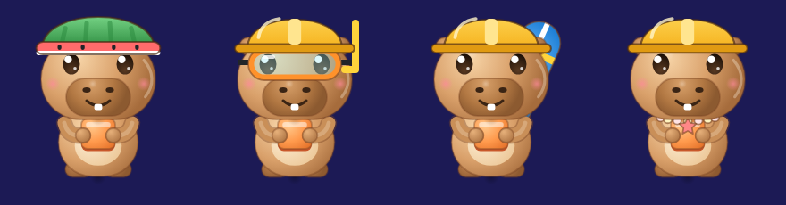

# Temporada de janeiro: Verão

Janeiro é férias e praia no Brasil. O Capi vai à praia: um chapéu que refresca, uma máscara para mergulhar nos combos, uma prancha e um colar com os achadinhos da areia.

| Item | id | Parte | Raridade | Como ganha |
|---|---|---|---|---|
| Chapéu de Melancia | `chapeu_melancia` | cabeça | lendário | **na compra do premium**, já vestido |
| Máscara de Mergulho | `mascara_mergulho` | rosto | raro | premium, nível 10 |
| Prancha de Surfe | `prancha_surfe` | costas | épico | premium, nível 20 |
| Colar de Conchas | `colar_conchas` | pescoço | comum | grátis, nível 25 |

Fora de janeiro, os itens somem do Guarda-Roupa de quem não tem e voltam em janeiro do ano seguinte. Quem tem continua com eles.

## Prompts para o Gemini

Mande `art/icone-fonte.jpg` junto, como referência de estilo. Salve cada imagem em `art/capi/fontes/itens/<id>.webp` e rode `python3 tool/capi_arte.py`. Depois, acrescente a posição do item em `ItemArte.todos` (`lib/ui/capi_arte.dart`). Enquanto a imagem não existe, o jogo usa o desenho provisório.

1. **chapeu_melancia:** "Só o objeto, no mesmo estilo 3D vinil brilhante da referência, de frente, sem personagem, fundo verde chapado #00FF00, quadrado 1024x1024: meia melancia usada como capacete, casca verde listrada por fora, borda vermelha com sementes pretas e uma faixa branca."
2. **mascara_mergulho:** "Só o objeto, no mesmo estilo 3D vinil brilhante da referência, de frente, sem personagem, fundo verde chapado #00FF00, quadrado 1024x1024: máscara de mergulho infantil com moldura laranja, vidro transparente azulado, alça preta e snorkel amarelo do lado direito."
3. **prancha_surfe:** "Só o objeto, no mesmo estilo 3D vinil brilhante da referência, sem personagem, fundo verde chapado #00FF00, quadrado 1024x1024: prancha de surfe azul com uma faixa branca no meio e uma faixa amarela, inclinada, vista de frente."
4. **colar_conchas:** "Só o objeto, no mesmo estilo 3D vinil brilhante da referência, de frente, sem personagem, fundo verde chapado #00FF00, quadrado 1024x1024: colar de conchinhas cor-de-rosa e creme com uma estrela-do-mar coral no meio."
